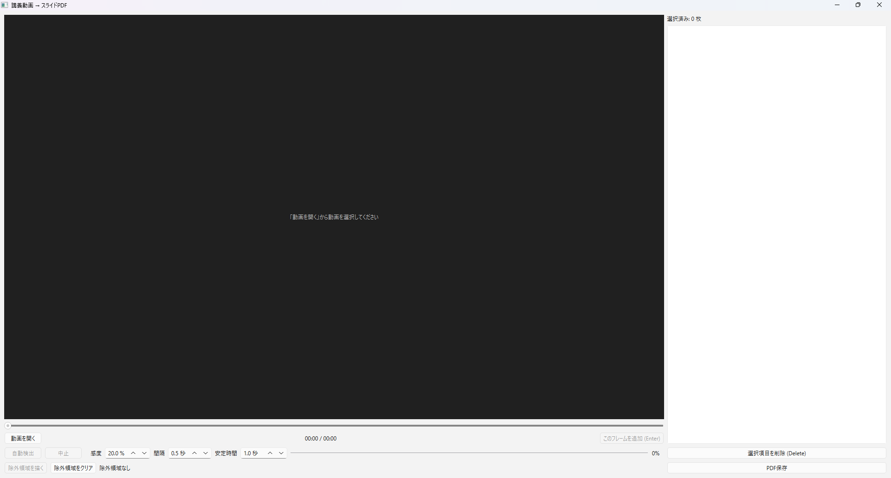

# SlideCapture


**講義動画からスライドの場面を選んで、1つのPDFにまとめるデスクトップアプリです。**

録画された講義を見返すとき、スライドだけを手元に残したいことがあります。SlideCapture では、シークバーで場面を探して選ぶだけでPDFを作れます。スライドの切り替わりを自動で見つける機能もあるので、30分の講義でも数分で資料にまとめられます。



## 主な機能

- **手動で選ぶ**：シークバーとキー操作（1秒／10秒／1フレーム送り）で場面を探し、Enter で追加します
- **切り替わりを自動検出**：スライドが変わった場面を候補として一覧に入れます
  - 箇条書きが順に表示されるスライドは、全項目が出そろった状態を1枚として扱います
  - フェード中の画面、黒画面、前のスライドに戻っただけの場面は候補から外します
- **除外領域**：顔出し映像や字幕など、動き続ける部分をドラッグで指定して、誤検出を防ぎます
- **一覧の編集**：ドラッグで並び替え、Delete で削除、ダブルクリックでその時刻へ移動できます
- **PDF保存の設定**：ページサイズ・解像度・画質を選べます。予想ファイルサイズもその場で表示します
- **ローカルで完結**：動画も画像もPCの外には送信しません

## ダウンロード

ビルド済みのアプリは [Releases](../../releases) にあります（公開している場合）。zip を展開して、中の `SlideCapture.exe`（Linux は `SlideCapture`）を起動してください。展開したフォルダは、中身を取り出さずにフォルダごと使ってください。

自分でビルドする場合や、Python から直接動かす場合は、以下の手順に従ってください。

## 動作環境

| 項目 | 内容 |
|---|---|
| OS | Windows 10 / 11、Linux（Ubuntu 22.04 など。WSL2 + WSLg も可） |
| Python | 3.10 以上（ソースから動かす・ビルドする場合） |
| 主なライブラリ | PySide6、OpenCV（headless）、PyMuPDF、NumPy |
| 対応動画 | mp4 / mkv / avi / mov / webm / m4v など、OpenCV（FFmpeg）で読める形式 |

macOS は動作未確認です。

## ビルド方法

ビルドには [PyInstaller](https://pyinstaller.org/) を使います。スクリプトが仮想環境 `.venv` の作成、ライブラリのインストール、ビルドまでを自動で行います。初回はダウンロードがあるため数分かかります。

### Windows

1. [Python](https://www.python.org/downloads/) をインストールする（インストール時に「Add python.exe to PATH」にチェック）
2. リポジトリを取得する

   ```bat
   git clone https://github.com/ZuyaTepo/SlideCapture.git
   cd SlideCapture
   ```

   **英数字だけのパス**（例：`C:\dev\SlideCapture`）に置いてください。

3. `build.bat` をダブルクリックする（またはコマンドプロンプトで実行する）

   ```bat
   build.bat
   ```

4. 次の場所にアプリができます

   ```
   dist\SlideCapture\SlideCapture.exe
   ```

exe を1つのファイルにまとめたい場合は `build.bat onefile` を実行してください。`dist\SlideCapture.exe` ができます。単体で持ち運べますが、起動のたびに一時展開するため数秒遅くなります。

### Linux（Ubuntu / Debian 系）

1. Python の仮想環境と、Qt の画面表示に必要なライブラリをインストールする

   ```bash
   sudo apt update
   sudo apt install -y python3-venv python3-pip git \
       libgl1 libegl1 libglib2.0-0 libfontconfig1 libdbus-1-3 \
       libxkbcommon-x11-0 libxcb-cursor0 libxcb-icccm4 libxcb-keysyms1 \
       libxcb-shape0 libxcb-randr0 libxcb-render-util0 libxcb-xinerama0 \
       fonts-noto-cjk
   ```

   `fonts-noto-cjk` は日本語フォントです。これがないと、画面の日本語が「□」で表示されることがあります。

2. リポジトリを取得してビルドする

   ```bash
   git clone https://github.com/ZuyaTepo/SlideCapture.git
   cd SlideCapture
   ./build.sh            # 1ファイルにまとめる場合は ./build.sh onefile
   ```

3. 起動する

   ```bash
   ./dist/SlideCapture/SlideCapture
   ./dist/SlideCapture/SlideCapture lecture.mp4    # 動画を指定して起動することもできる
   ```

Linux 版は、ビルドした環境より古いディストリビューションでは動かないことがあります。配布する場合は、対象の中で最も古い環境でビルドしてください。

### WSL2 の場合

Windows 11 の WSL2 には GUI 表示機能（WSLg）が標準で入っているため、Linux と同じ手順でビルドして起動できます。Windows 側の動画は `/mnt/c/Users/<ユーザー名>/Videos/...` のように開けます。

なお、WSL でビルドしてできるのは **Linux 用**の実行ファイルです。Windows 用の exe は、Windows 上で `build.bat` を使って作ってください。

## ビルドせずに動かす

```bash
python -m venv .venv
# Windows:      .venv\Scripts\activate
# Linux / WSL:  source .venv/bin/activate
pip install -r requirements.txt
python slide_capture.py
```

Linux では、上の「Linux」の手順1のライブラリも必要です。

## 使い方

1. **動画を開く**：「動画を開く」から講義動画を選びます
2. **（任意）除外領域を描く**：顔出し映像などがある場合は、「除外領域を描く」をオンにして、プレビュー上をドラッグします
3. **自動検出**：「自動検出」を押すと、スライドの候補が「（自動）」付きで一覧に入ります
4. **確認・修正**：不要な候補は Delete で削除し、足りない場面はシークして Enter で追加します。順番はドラッグで入れ替えられます
5. **PDF保存**：「PDF保存」で設定を選び、保存先を指定します

### キー操作

| キー | 動作 |
|---|---|
| ← / → | 1秒戻る / 進む |
| Shift + ← / → | 10秒戻る / 進む |
| , / . | 1フレーム戻る / 進む |
| Enter / Space | 現在のフレームを一覧に追加 |
| Delete | 一覧で選択中の項目を削除 |
| Esc | 除外領域の描画モードを終了 |
| 右クリック（プレビュー上） | その位置の除外領域を削除 |

### 自動検出の設定

| 設定 | 初期値 | 調整の目安 |
|---|---|---|
| 感度 | 20% | 切り替わりを見逃すなら下げる。余計な候補が多いなら上げる |
| 間隔 | 0.5秒 | 長くすると速くなるが、短時間しか映らないスライドを見逃しやすくなる |
| 安定時間 | 1.0秒 | アニメーションの途中が候補に入るなら長くする |

### PDF保存の設定

| 設定 | 選択肢（初期値は太字） |
|---|---|
| ページサイズ | **スライド（幅10インチ、PowerPointと同じ）** ／ A4横 ／ 画像の画素数に合わせる |
| 画像の解像度（幅） | 元のまま ／ **1920px** ／ 1600px ／ 1280px ／ 960px |
| 画像形式 | **JPEG（容量が小さい）** ／ PNG（劣化なし） |
| JPEG画質 | 30〜100（**85**） |

目安として、1080p のスライド20枚を初期設定で保存すると約3MB になります。もっと軽くしたい場合は、1280px・JPEG画質80 程度にしても文字は十分読めます。選んだ設定は次回も引き継がれます。

## 自動検出のしくみ

一定間隔でフレームを取り出し、文字や図の輪郭（エッジ）を比べています。

1. 前後のフレームでエッジがほとんど変わらなければ、画面が「安定」しているとみなします
2. 安定した画面どうしを比べて、**前の画面にあった文字や図が一定割合以上消えていたら**、スライドが切り替わったと判定します
3. 切り替わる直前の安定した画面を、候補として一覧に入れます

文字が「増える」だけの変化（箇条書きの段階表示や書き込み）では何も消えないため、同じスライドの続きとして扱います。除外領域に指定した部分は、比較の対象から外します。

## トラブルシューティング

| 症状 | 対処 |
|---|---|
| 動画を開けない（Windows） | パスに日本語が含まれていると開けないことがあります。英数字のフォルダ名・ファイル名で試してください |
| 「WindowsによってPCが保護されました」と表示される | 署名のない自作アプリのため表示されます。「詳細情報」→「実行」で起動できます |
| Linux で起動しない（`xcb` 関連のエラー） | Linux のビルド手順1のライブラリが入っているか確認してください |
| 画面の日本語が「□」になる（Linux） | `sudo apt install fonts-noto-cjk` を実行してください |
| 切り替わりを見逃す／候補が多すぎる | 自動検出の「感度」を調整してください |
| 顔出し映像があると候補が出ない | その部分を除外領域に指定してください |
| 予期しないエラーで止まった | ホームフォルダの `slide_capture_error.log` に詳細が記録されています |

## ファイル構成

```
SlideCapture/
├── slide_capture.py      アプリ本体
├── requirements.txt      必要なライブラリ
├── slide_capture.spec    PyInstaller のビルド設定
├── build.bat             Windows 用ビルドスクリプト
├── build.sh              Linux / WSL 用ビルドスクリプト
├── app.ico               アプリのアイコン
└── README.md
```

## 注意事項

講義動画やスライドの著作権は、講義の担当者や大学などにあります。このツールで作成したPDFは個人の学習の範囲で利用し、所属機関のルールに従ってください。再配布や公開はしないでください。

## ライセンス

[GNU Affero General Public License v3.0](LICENSE)

このアプリは、AGPL-3.0 で提供されている [PyMuPDF](https://github.com/pymupdf/PyMuPDF) を使用しているため、同じ AGPL-3.0 で公開しています。その他の主な依存ライブラリのライセンスは次のとおりです。

| ライブラリ | ライセンス |
|---|---|
| [PySide6](https://doc.qt.io/qtforpython-6/) | LGPL-3.0 |
| [OpenCV](https://opencv.org/) | Apache-2.0 |
| [NumPy](https://numpy.org/) | BSD-3-Clause |
| [PyMuPDF](https://github.com/pymupdf/PyMuPDF) | AGPL-3.0 |
